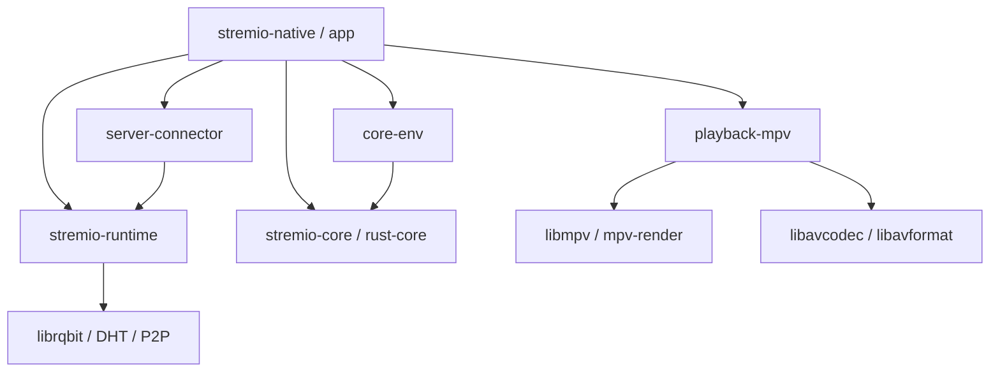
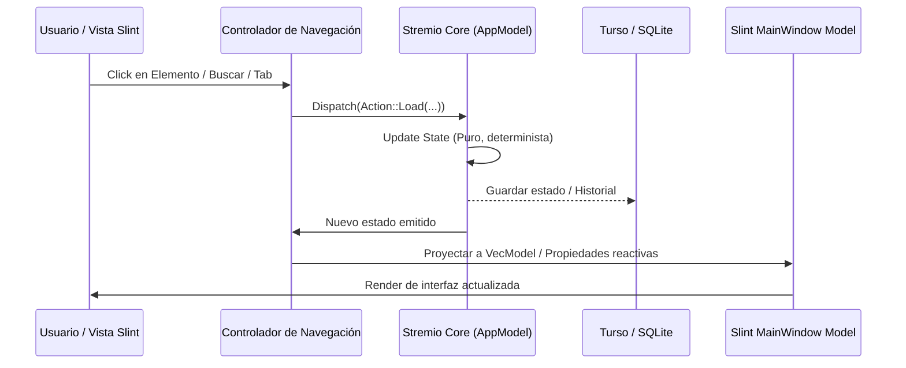

# Arquitectura del Sistema: Stremio-Native

## 1. Visión General y Objetivos de Diseño

**Stremio-Native** es una implementación de cliente de escritorio para el ecosistema Stremio construida completamente en **Rust**, eliminando las capas de abstracción pesadas de los clientes basados en Electron/Chromium (como `stremio-shell` oficial).

### Objetivos Clave:
1. **Rendimiento y Baja Latencia:** Arranque en frío en menos de 200 ms, renderizado a 60/120+ FPS y uso de memoria entre 3x y 5x menor comparado con Electron.
2. **Cero Dependencias Web Runtimes:** Reemplazo de Chromium por el motor declarativo nativo **Slint** compilado a código máquina con backend gráfico OpenGL (**FemtoVG**).
3. **Reproducción de Medios Inmersiva y Nativa:** Integración directa con **libmpv** (`playback-mpv`) mediante buffers OpenGL compartidos, aceleración por hardware (VA-API, NVDEC, D3D11VA) y pipeline de shaders de escalado (FSR, Anime4K).
4. **Motor Torrent Embebido sin Node.js:** Ejecución en proceso del motor de streaming P2P vía `stremio-runtime` (`librqbit`), gestionando DHT, UPnP, transcodificación HLS y peticiones HTTP por rangos directamente en memoria.
5. **Persistencia Local Rápida:** Base de datos embebida Turso/SQLite en modo WAL para almacenar caché de metadatos, historial, biblioteca sincronizada y estados de sesión con transacciones ACID.

---

## 2. Topología del Espacio de Trabajo (Cargo Workspace)

El proyecto está organizado como un workspace modular de Rust:



### Detalle de Módulos:

| Crate / Módulo | Propósito y Responsabilidades |
| :--- | :--- |
| **`app`** | Binario principal. Inicialización del shell, árbol UI Slint (`app.slint`), controlador de navegación, mapeo de modelos a vistas, persistencia de geometría de ventanas, bandejas del sistema (tray), atajos de teclado y manejador de crasheos en proceso con stack aislado. |
| **`playback-mpv`** | Capa de abstracción de reproducción multimedia. Aloja el actor en hilo dedicado para `libmpv`, sincronización de textura OpenGL, configuración dinámica de shaders GLSL, previsualización de fotogramas clave (*keyframes*) en la barra de tiempo (`KeyframeThumbnailer`) y audio espacial/estéreo. |
| **`stremio-runtime`** | Motor de streaming local autónomo. Levanta un servidor HTTP local implementando una estrategia de enlace preferencial en `127.0.0.1:11470` (por compatibilidad con addons externos) con fallback automático a puerto efímero (`127.0.0.1:0`) si está ocupado por otra instancia, inyectando la URL base resultante a `server-connector`. Implementa cliente BitTorrent de alto rendimiento (`librqbit`), motor DHT y orquestación de buffers de reproducción. |
| **`core-env`** | Adaptador de entorno para `stremio-core`. Implementa los *traits* de persistencia local, ejecución de temporizadores asíncronos y peticiones de red utilizando el runtime Tokio. |
| **`server-connector`** | Conector cliente HTTP para comunicarse de forma eficiente con el motor de streaming embebido y servicios de desbridado remoto (RealDebrid, AllDebrid, etc.). |

---

## 3. Modelo de Hilos y Concurrencia

Para mantener la interfaz completamente fluida y libre de micro-bloqueos (*jank*), `stremio-native` aplica una separación estricta de responsabilidades en diferentes hilos del sistema operativo:

```
[ Sistema Operativo / Pantalla ]
           ▲
           │ Presentación OpenGL (FemtoVG / VSync)
           ▼
┌────────────────────────────────────────────────────────┐
│ 1. HILO PRINCIPAL DE UI (Slint Event Loop + Winit)    │
│    - Procesamiento de eventos de ventana (Wayland/X11)│
│    - Renderizado de interfaz declarativa               │
│    - Despacho de proyecciones reactivas a la UI       │
└───────────┬────────────────────────────────────────────┘
            │ Canales MPSC / Arc / Atomicos
            ▼
┌────────────────────────────────────────────────────────┐
│ 2. RUNTIME ASÍNCRONO TOKIO (Multi-threaded Pool)       │
│    - Consultas HTTP a Addons y APIs de Metadatos       │
│    - Escrituras a SQLite / Turso en modo WAL           │
│    - Servidor HTTP de stremio-runtime (P2P/Streaming)  │
└───────────┬────────────────────────────────────────────┘
            │
            ├────────────────────────────────────────────┐
            ▼                                            ▼
┌──────────────────────────────┐ ┌─────────────────────────────────────────┐
│ 3. HILO DEDICADO MPV ACTOR   │ │ 4. HILO DEDICADO FFMPEG THUMBNAILER     │
│    - Bucle de eventos libmpv │ │    - Extracción bajo demanda de I-Frames│
│    - Decodificación por GPU  │ │    - Escalador swscale con alineación   │
│    - Sincronización A/V      │ │    - Descartado de peticiones vencidas  │
└──────────────────────────────┘ └─────────────────────────────────────────┘
```

1. **Hilo Principal (UI & Render):** Corre el bucle de eventos de `winit` y el motor de dibujo `FemtoVG`. No realiza ninguna operación sincrónica de disco ni red.
2. **Tokio Runtime (Worker Pool):** Gestiona la concurrencia asíncrona de I/O, el motor `librqbit`, el servidor `stremio-service-rs` y las sincronizaciones de la base de datos Turso.
3. **MPV Actor Thread:** Hilo nativo aislado que gestiona el contexto de `libmpv`. Responde a cambios de posición, comandos de pausa y volumen sin que los retrasos de decodificación congelen la UI.
4. **FFmpeg Thumbnailer Thread:** Hilo con cola de trabajo amortiguada (*debounced channel*) dedicado a extraer miniaturas para el hover de la barra de progreso sin competir con los recursos de Tokio.

---

## 4. Flujo de Datos Unidireccional y Proyección Reactiva

La arquitectura sigue el patrón unidireccional de `stremio-core` inspirado en Elm/Redux:



1. **Acción (`Action`):** Cualquier interacción de la UI o evento de red se despacha como un comando fuertemente tipado.
2. **Actualización Determinista (`Update`):** `stremio-core` procesa el estado anterior y la acción, produciendo el nuevo estado de forma pura y efectos secundarios (*Effects*).
3. **Capa de Proyección:** Funciones de mapping en `app/src/` transforman estructuras de Rust en tipos compatibles con Slint (`SharedString`, `ModelRc<T>`, `SharedPixelBuffer<Rgba8Pixel>`).

---

## 5. Integración de Reproducción de Video (MPV & OpenGL)

El módulo `playback-mpv` interactúa directamente con el pipeline de renderizado:

1. **Presentación de Video y Composición (FBO compartido):**
   - El diseño definitivo es **FBO compartido**: Slint y `libmpv` comparten el contexto OpenGL (`mpv_render_context_create`) y MPV renderiza en un par de texturas privadas de doble búfer, que Slint muestrea como una imagen más.
   - `MPV_EVENT_RENDER_UPDATE` se procesa en el hilo de UI; el FBO evita conflictos de z-order, mantiene el OSD (blur, bordes redondeados, animaciones) en el mismo árbol de composición y funciona igual en X11, Wayland y Windows.
   - El doble búfer evita que Slint muestree la textura que MPV está escribiendo. No hay `glFinish`/`glReadPixels` en el camino caliente.
   - **Trabajo futuro (no implementado):** overlay por `wl_subsurface`/DMA-BUF en Wayland o DirectComposition en Windows. Hoy no existe ninguna ruta de subsuperficie en el código; el FBO es el modo único y estable.
2. **Shaders y Post-procesamiento:**
   - Soporte para perfiles de shaders GLSL dinámicos (Anime4K, FSR) inyectados directamente al pipeline de MPV mediante `mpv_set_property_string(..., "glsl-shaders", ...)`.
3. **Decodificación por Hardware:**
   - Selección automática del decodificador disponible (`hwdec="auto-safe"`), priorizando VA-API en Linux/Intel/AMD, NVDEC en Nvidia y D3D11VA en Windows.

---

## 6. Persistencia y Configuración de Ventana

### Almacenamiento Local (Turso / SQLite):
- Ruta base en Linux: `~/.local/share/stremio-native/`
- La base de datos `stremio.db` corre con `journal_mode = WAL`, `synchronous = NORMAL`, `mmap_size = 30000000` (~30 MB de Memory-Mapped I/O) y `cache_size = -4000` (4 MB) en `app/src/db.rs`, y `cache_size = -2000` (2 MB) en la conexión compartida de `core-env`. Este dimensionamiento mantiene lecturas rápidas y el RSS dentro del presupuesto de memoria.
- Almacena perfiles de usuario, catálogo de addons instalados, historial de búsqueda, caché de progreso de episodios y configuración general (`app_config`).

### Persistencia de Geometría de Ventana:
- El hook de eventos de ventana (`window_events.rs`) intercepta eventos nativos de Winit:
  - `WindowEvent::Resized`: Detecta y amortigua (*debounce* de 500 ms) cambios de tamaño manuales.
  - `WindowEvent::Focused(false)` y `WindowEvent::CloseRequested`: Persisten de inmediato las dimensiones (`window_width`, `window_height`) y el estado de maximizado (`window_maximized`).
  - Al iniciar, `finish_startup` lee los valores persistidos y restaura de forma invisible el tamaño o estado maximizado exacto antes de completar la carga.

### Integración Wayland y Entornos de Escritorio (KDE Plasma / GNOME):
- **Identidad de Aplicación:** Se invoca `slint::set_xdg_app_id("stremio-native")` antes de crear la ventana principal.
- **Desktop Entry:** El archivo `.desktop` define `StartupWMClass=stremio-native`, garantizando que en Wayland el compositor asocie unívocamente la ventana con el lanzador anclado en la barra de tareas, eliminando el problema de iconos duplicados.
- **Bandeja del Sistema (Tray):** Implementado vía el protocolo D-Bus StatusNotifierItem (`ksni`) sin instanciar ventanas ocultas del compositor.

---

## 7. Gestión de Memoria y Optimización de Recursos

A diferencia de clientes basados en Chromium que reservan gigabytes de memoria:

1. **Asignador mimalloc:**
   - Se utiliza `mimalloc` configurado con descarte inmediato de páginas no utilizadas (`MIMALLOC_ARENA_EAGER_COMMIT=0`, `MIMALLOC_PURGE_DECOMMITS=1`).
   - Tarea periódica de desfragmentación en background que invoca `trim_process_memory()`.
2. **Caché Acotado de Imágenes (`moka`):**
   - Imágenes de carátulas y fondos se almacenan en un caché LRU acotado por peso en bytes (`SharedPixelBuffer<Rgba8Pixel>`), garantizando que la memoria de texturas se libere automáticamente tras navegar por catálogos grandes.
3. **Prevención de Pérdidas de Memoria:**
   - Las conexiones de red y sesiones de previsualización no concurrentes se cierran y limpian de inmediato tras perder el foco o cambiar de catálogo.

---

## 8. Seguridad y Tolerancia a Fallos

1. **Manejador de Crashes en Proceso (0 Procesos Hijos en Reposo):**
   - Para cumplir estrictamente con el objetivo de proceso único (1 solo proceso en el árbol del SO), la captura de fallos se implementa mediante `crash-handler` en proceso, reservando un stack de señales alternativo (`sigaltstack`).
   - Ante una señal fatal (como `SIGSEGV` o `SIGABRT` originada en C/FFmpeg/libmpv), el handler escribe el minidump (`minidump-writer`) de forma segura bajo demanda e invoca el binario de reporte únicamente en el instante del fallo, sin mantener procesos secundarios residentes en memoria durante la ejecución normal.
2. **Protección de Enlaces Debrid:**
   - El sistema de generación de URLs y thumbnails protege las peticiones de proveedores Debrid evitando aperturas concurrentes múltiples que puedan causar invalidación o bloqueos de la cuenta de usuario.
3. **Recuperación de Bloqueos de Base de Datos:**
   - Mecanismo de adquisición de candado con reintentos exponenciales y liberación automática de bloqueos huérfanos generados por apagados abruptos.

---

## 9. Arquitectura de Compilación (Build Architecture)

El pipeline de compilación de **Stremio Oxide** está optimizado para generar binarios nativos monolíticos de alto rendimiento, reduciendo el overhead de enlace y facilitando la reproducibilidad multiplataforma.

### 9.1 Cadena de Herramientas y Toolchain
- **Compilador Rust:** Edición 2021/2024 (soporte para Rust estable 1.80+ y canales nightly para optimizaciones específicas de ABI y SIMD).
- **Herramientas de Compilación C/C++:** CMake, Ninja y LLVM/Clang (requerido para `libclang` y la generación de bindings FFI vía `autocxx` y `bindgen`).
- **Linkers de Alto Rendimiento:**
  - En Linux: Soporte y uso prioritario de `mold` (`mold -run cargo build`) para reducir los tiempos de enlace final de ~40s a < 2s.
  - En Windows: `link.exe` de Microsoft Visual C++ (MSVC) configurado para resolver dependencias dinámicas o estáticas con compatibilidad de runtime universal C (UCRT).

### 9.2 Pipeline de Dependencias Nativas y Vcpkg
El proyecto combina resolución de librerías del sistema con empaquetado estático hermético vía `vcpkg`:
1. **Librería de Reproducción (`libmpv`):**
   - En Linux: Detección automática en tiempo de compilación mediante `pkg-config` (`libmpv-dev`), enlazando dinámicamente con las bibliotecas multimedia del sistema.
   - En Windows: Descarga y staging automatizado de la versión de desarrollo de `libmpv-2.dll`, con inclusión de cabeceras C en tiempo de build e instalación app-local del runtime DLL en la distribución.
   - En macOS: Resolución vía Homebrew (`brew --prefix mpv`) con enlaces a los frameworks nativos de Apple (VideoToolbox, AudioToolbox, Cocoa).
2. **Motor BitTorrent Estático (`libtorrent` / `rqbit`):**
   - Integración con `vcpkg` mediante triplets personalizados (`x64-windows-static-md-release`, `arm64-windows-static-md-release`, `x64-linux-v3-static-release`).
   - Permite la compilación estática de dependencias pesadas de red y criptografía (Boost, OpenSSL estático) sin contaminar las librerías dinámicas del sistema operativo anfitrión.

### 9.3 Compilación Anticipada de UI (Slint AOT)
- La interfaz de usuario escrita en Slint se compila anticipadamente (Ahead-Of-Time) dentro de `app/build.rs` usando `slint-build`.
- Los archivos `.slint` se transforman directamente en código Rust estructurado y optimizado con bindings de propiedades de tiempo constante.
- Inyección dinámica de tipografías: `app/build.rs` procesa los archivos TTF de fuentes de iconos (Bootstrap Icons, Lucide) y genera automáticamente `imported_fonts.slint` antes de que el parser de Slint analice los componentes de la interfaz.

### 9.4 Perfiles de Optimización de Cargo
- **Perfil `release`:**
  - `opt-level = 3`: Máxima optimización de código máquina.
  - `panic = "abort"`: Eliminación del código de desenrollado de pila (*unwinding*), reduciendo el tamaño del binario y eliminando tablas de excepciones.
  - `strip = true`: Eliminación completa de símbolos de depuración no esenciales en el ejecutable final.
  - `build-override { opt-level = 1 }`: Aceleración del compilador AOT de Slint y macros procedurales durante la fase de compilación.
- **Perfil `dev`:**
  - `opt-level = 0`, `incremental = true`, `split-debuginfo = "unpacked"` para ciclos de iteración rápidos sin regenerar artefactos redundantes.

### 9.5 Empaquetado y Distribución Automatizada
El sistema de CI/CD automatiza la generación de instaladores y paquetes nativos para los principales sistemas operativos:
- **Linux:**
  - Paquetes Debian/Ubuntu (`.deb`) generados mediante `cargo-deb`, registrando dependencias dinámicas, lanzador `.desktop`, iconos escalables y metadatos de appstream.
  - Paquetes Fedora/RHEL (`.rpm`) construidos con `rpmbuild` en contenedores limpios.
  - Paquetes Arch Linux (`.pkg.tar.zst`) generados vía `makepkg` y `PKGBUILD`.
- **Windows:**
  - Instalador ejecutable (`StremioSetup-v*.exe`) empaquetado con **Inno Setup 6** (`ISCC.exe`), incluyendo registro de desinstalador, accesos directos, binarios DLL de MPV y staging de redistribuibles MSVC (`scripts/stage_windows_msvc_runtime.ps1`).
  - Archivos portables ZIP para el mecanismo de auto-actualización (`self_update`).
- **macOS:**
  - Binarios optimizados para Apple Silicon (M1/M2/M3/M4) e Intel x86_64, empaquetados en archivos comprimidos listos para ejecución local.

---

## 10. Agradecimientos y Créditos de Componentes

**Stremio Oxide** es posible gracias a la labor de destacados desarrolladores y comunidades de código abierto que diseñaron las tecnologías sobre las que se apoya:

1. **SmartCode Ltd (Ecosistema Stremio):**
   - Creadores de la plataforma original Stremio.
   - Autores de la arquitectura de addons de streaming y los modelos centrales de catálogos y enriquecimiento de metadatos.
2. **Matthew Shaji (`perpetus` / `stremio-native`):**
   - Autor del proyecto original `stremio-native`, quien demostró la viabilidad de prescindir de Electron y estableció el puerto inicial en Rust y Slint.
3. **SixtyFPS GmbH (Equipo de Slint):**
   - Creadores del framework de interfaz de usuario Slint, permitiendo un desarrollo de UI declarativo, reactivo y de bajísimo consumo de memoria con backend nativo OpenGL/FemtoVG.
4. **Proyecto MPV (`libmpv`):**
   - El equipo de desarrollo de `mpv` por proveer el motor de reproducción multimedia libre más avanzado, flexible y eficiente del ecosistema de código abierto.
5. **Igor Izyumin (`librqbit` / `rqbit`):**
   - Creador del motor BitTorrent y cliente DHT en Rust puro, base del streaming P2P embebido sin dependencias externas.
6. **po5 (`ThumbFast`):**
   - Por las técnicas y heurísticas de búsqueda asíncrona de fotogramas clave (*keyframes*) para previsualizaciones de video en línea de tiempo.
7. **Comunidad y Ecosistema de Rust:**
   - A los mantenedores de los crates fundamentales del proyecto:
     - `tokio` (runtime asíncrono para I/O y tareas de red concurrentes).
     - `rusqlite` y `turso` (persistencia local embebida con transacciones seguras).
     - `moka` (caché concurrente de imágenes y metadatos en memoria).
     - `mimalloc` (asignador de memoria de alta eficiencia y compactación).
     - `winit` (gestión de ventanas nativas multiplataforma).
     - `ksni` (soporte de bandeja del sistema en entornos Linux/XDG).
     - `souvlaki` (integración con controles multimedia nativos del sistema operativo).
